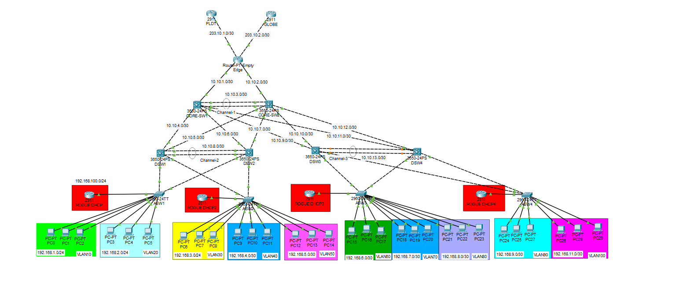

# Cisco Networking Labs – Day 25

<p align="center">
  
</p>

<p align="center">
  <b>Complete Cisco Networking Lab | Day 1–25</b>
</p>

<p align="center">
  Hands-on networking practice using Cisco Packet Tracer.
</p>

---

## 📌 About This Project

This repository contains my hands-on Cisco networking labs, covering fundamental to advanced networking concepts through practical network configuration, implementation, and troubleshooting.

The **Day 25 – Complete Networking Lab** is a consolidated Cisco Packet Tracer project that brings together the networking concepts practiced throughout my learning journey.

The main objective is to strengthen my understanding of enterprise networking, routing, switching, network services, network security, and troubleshooting through hands-on experience.

## 🎯 Topics Covered

### 1. Switching and VLANs
- VLAN configuration and management
- Access and trunk ports
- 802.1Q encapsulation
- Inter-VLAN routing
- Switch Virtual Interfaces (SVI)
- VLAN troubleshooting

### 2. Spanning Tree Protocol
- Spanning Tree Protocol (STP)
- Rapid Spanning Tree Protocol (RSTP)
- Root Bridge election
- Bridge Priority and Path Cost
- PortFast
- BPDU Guard
- Root Guard
- Layer 2 loop prevention

### 3. EtherChannel
- Port-channel configuration
- Link Aggregation Control Protocol (LACP)
- EtherChannel troubleshooting
- Layer 2 EtherChannel
- Layer 3 EtherChannel

### 4. Routing Protocols
- Static Routing
- Dynamic Routing
- Enhanced Interior Gateway Routing Protocol (EIGRP)
- EIGRP Neighbor Relationships
- Administrative Distance
- Metric Calculation
- Route Selection
- Auto-Summary and `no auto-summary`

### 5. DHCP and Network Services
- DHCP Server Configuration
- DHCP Pools
- DHCP Relay
- DHCP Snooping
- Trusted and Untrusted Interfaces
- DHCP Binding Verification
- DHCP Option 82

### 6. Network Security
- Standard Access Control Lists (ACLs)
- Extended Access Control Lists (ACLs)
- ACL Implementation
- DHCP Snooping
- Network Traffic Filtering

### 7. Advanced Networking
- IP SLA concepts
- Network Redundancy
- ISP Connectivity
- Multi-WAN concepts
- Routing Troubleshooting
- Multi-VLAN Network Design

## 🛠️ Tools and Technologies

- Cisco Packet Tracer
- Cisco IOS CLI
- Routers and Layer 2/Layer 3 Switches
- Network Troubleshooting Commands

## 📂 Project Structure

```text
Networking-Day-25/
│
├── README.md
├── DAY25 all covered.pkt
│
└── image_2026-11-19_113936429.png
```

## 🚀 How to Use

1. Clone or download this repository.
2. Install Cisco Packet Tracer.
3. Open `DAY25 all covered.pkt`.
4. Explore the complete network topology.
5. Inspect device configurations using the CLI.
6. Test connectivity using `ping` and `traceroute`.
7. Practice troubleshooting by identifying and resolving network issues.

## 🔍 Useful Troubleshooting Commands

**Interface and VLAN Verification**
```bash
show ip interface brief
show vlan brief
show interfaces trunk
```

**Spanning Tree Verification**
```bash
show spanning-tree
show spanning-tree summary
```

**EtherChannel Verification**
```bash
show etherchannel summary
show etherchannel port-channel
```

**Routing Verification**
```bash
show ip route
show ip protocols
show ip eigrp neighbors
show ip eigrp topology
```

**DHCP Verification**
```bash
show ip dhcp binding
show ip dhcp pool
show ip dhcp snooping
```

**Access Control List Verification**
```bash
show access-lists
show ip interface
```

## 📚 Learning Objectives

Through these hands-on networking labs, I aim to develop practical skills in:

- Designing and implementing enterprise networks.
- Configuring Cisco routers and switches.
- Understanding Layer 2 and Layer 3 operations.
- Implementing routing and switching protocols.
- Configuring network security features.
- Managing DHCP services and network connectivity.
- Diagnosing and troubleshooting network issues.
- Understanding how different networking technologies work together.

## 📈 Learning Journey

**Day 1 – Day 25: Networking Fundamentals to Advanced Networking**

This project represents my continuous learning journey in computer networking through hands-on configuration, experimentation, and troubleshooting.

Instead of simply studying networking concepts, I practice implementing them in simulated network environments to develop practical troubleshooting and configuration skills.

More networking labs and experiments will be added as I continue improving my knowledge and skills.

---

## 👨‍💻 Author

**Jhommuel Pastoral**

- GitHub: [@JhommuelPastoral](https://github.com/JhommuelPastoral)
- Repository: [Networking-Day-25](https://github.com/JhommuelPastoral/Networking-Day-25)

---

